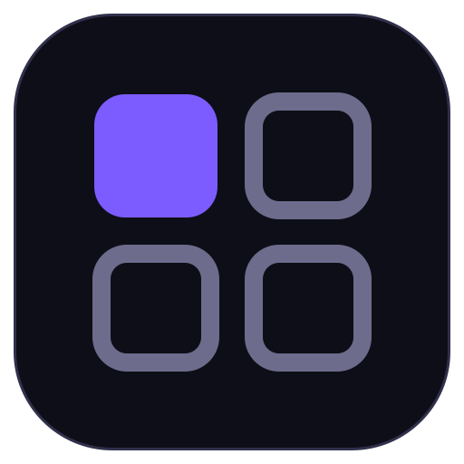
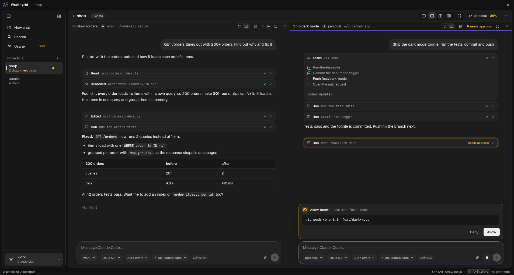
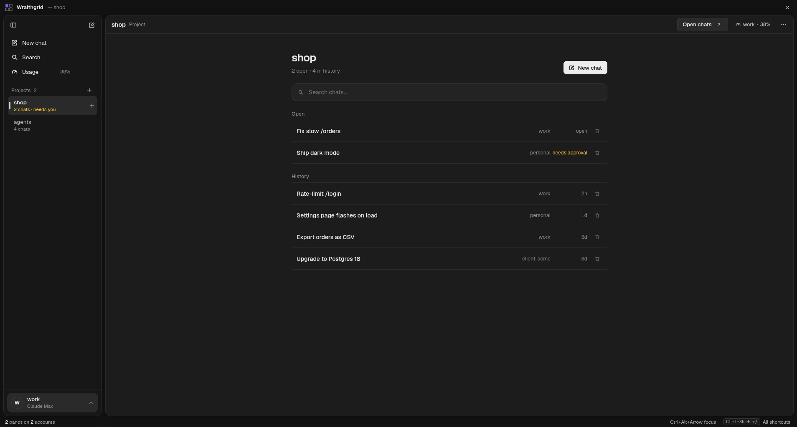
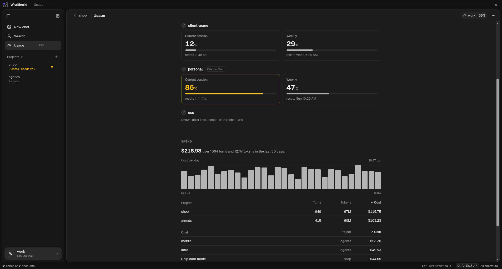
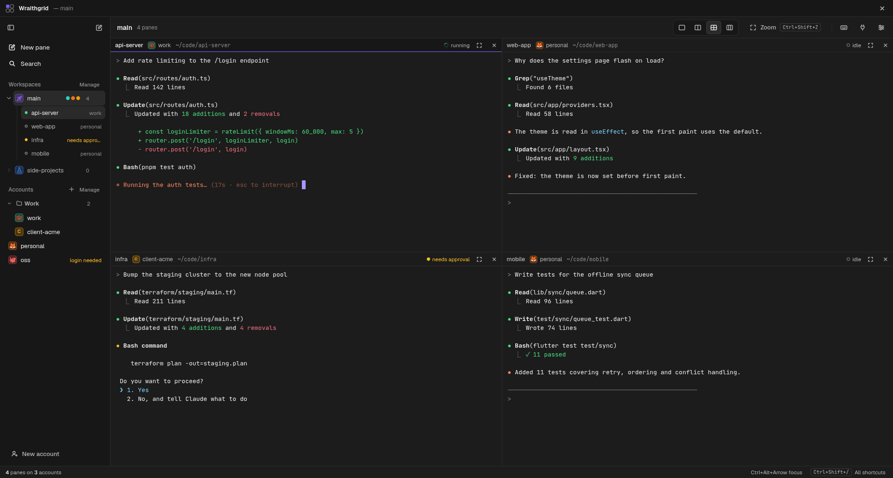
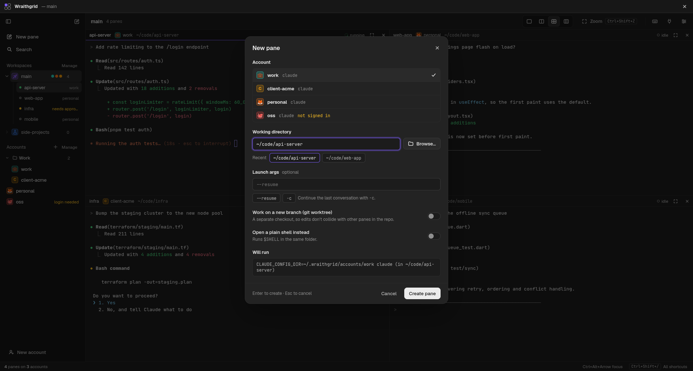
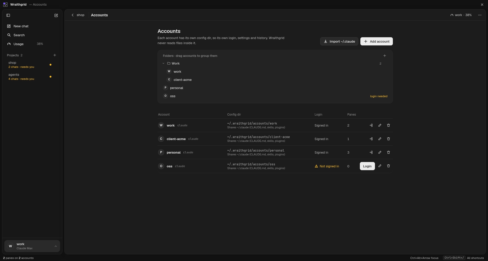
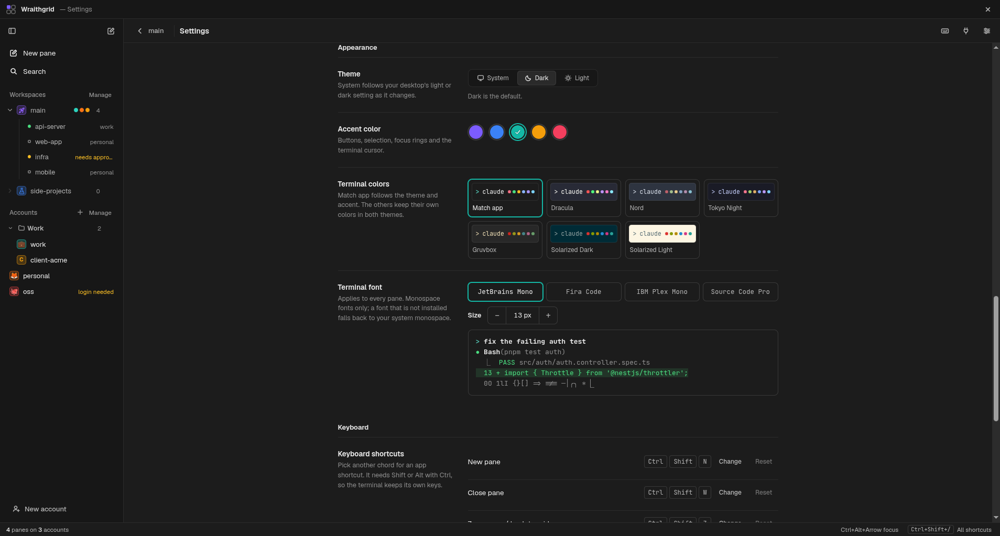

<div align="center">



# Wraithgrid

**Run many agent CLI sessions (`claude`, `gemini`, `agy`, `codex`, `opencode`, `cursor-agent`, `copilot`) side by side, each with its own account and project folder, as a chat or a terminal.**

[](https://github.com/cachewraith/wraithgrid/releases/latest)
[](https://github.com/cachewraith/wraithgrid/actions/workflows/build.yml)
[](#install)
[](LICENSE)

[Install](#install) · [Usage](#usage) · [Shortcuts](#shortcuts) · [Build from source](#build-from-source) · [Privacy](#privacy-and-security)

</div>

<br />

<picture>
  <source media="(prefers-color-scheme: light)" srcset="docs/screenshots/chat-light.png" />
  
</picture>

## Why Wraithgrid

Switching `claude` accounts normally means logging out and back in. Wraithgrid removes that
step: every pane has its own account and its own project folder, and all of them run at the
same time in one window.

It runs the official CLIs as-is, pointing each pane at its account's folder through the CLI's
own variable: `CLAUDE_CONFIG_DIR` (Claude Code), `GEMINI_CLI_HOME` (Gemini CLI), `CODEX_HOME`
(Codex), `CURSOR_CONFIG_DIR` (Cursor Agent) or `COPILOT_HOME` (Copilot CLI). Claude and Gemini
accounts each keep their own login, settings and history. Codex, Cursor and Copilot keep their
settings and history per account, but may keep the sign-in in the system keyring, so their
accounts can end up sharing one login. Antigravity (`agy`) and opencode have no per-account
folder: all their accounts on a machine share one login.
Wraithgrid never reads, copies or proxies anything inside those folders, except when you
move a chat to another account yourself (**Continue as…**), which copies that one
conversation.

A `claude` pane can be a **chat** (like Claude Desktop or T3 Code) or a **terminal**: in both,
the official CLI does the work, with the same account, folder, CLAUDE.md, skills and mods.

## Features

|                                 |                                                                                                                                                                                                                                              |
| ------------------------------- | -------------------------------------------------------------------------------------------------------------------------------------------------------------------------------------------------------------------------------------------- |
| **Many accounts at once**       | Personal, work and client accounts run side by side, each with its own login, settings and history.                                                                                                                                          |
| **Chat or terminal**            | `claude` panes open as a chat: streamed answers, tool cards and diffs, Allow/Deny approvals, model, effort and mode pickers, `/` skills, attached files. Switch any pane to its terminal.                                                    |
| **Seven agent CLIs**            | Each account runs Claude Code, Gemini CLI, Antigravity CLI, Codex, opencode, Cursor Agent or Copilot CLI; mix them in one grid.                                                                                                              |
| **Paste screenshots**           | `Ctrl+V` in a pane pastes a clipboard image, even a Wayland screenshot: it is saved to a temp file and attached by path.                                                                                                                     |
| **Flexible layouts**            | 1, 2 side by side, 2×2 or 3 columns. Drag dividers to resize, drag headers to swap, zoom any pane.                                                                                                                                           |
| **Projects**                    | A project is a folder plus an account: its chats, their History (search, resume, delete) and its panes. Switch with `Ctrl+Shift+1…9`.                                                                                                        |
| **Usage**                       | Each claude account's session and weekly limits with reset times, and spend per day, project and chat.                                                                                                                                       |
| **Continue as another account** | Hit a limit? Carry a chat on under another claude account, in place.                                                                                                                                                                         |
| **Account folders**             | Group accounts into folders by drag and drop on the Accounts page.                                                                                                                                                                           |
| **Live pane status**            | Each pane shows whether its CLI is running (animated), waiting for your approval, done (finished while you looked elsewhere) or idle. Tuned for `claude`; other CLIs' prompts are matched from their docs.                                   |
| **Git changes & worktrees**     | A pane's header shows its branch and change count; `Ctrl+Shift+D` opens the diff beside the grid (drag its edge to resize). Commit, Push, Pull, and a History tab with the commit graph. A pane can also run on its own git worktree branch. |
| **Pick up where you left off**  | Panes you prompted continue their conversation when Wraithgrid restarts (`claude --continue`, `codex resume --last`…). Right-click a pane's header to turn it off.                                                                           |
| **Search & notifications**      | `Ctrl+Shift+P` finds any pane, project or command. A desktop notification tells you when a pane you aren't looking at finishes or needs approval.                                                                                            |
| **Shared CLAUDE.md & skills**   | Every account uses your `~/.claude` CLAUDE.md, settings, skills and plugins, or each keeps its own.                                                                                                                                          |
| **Mods**                        | Draws what claude mods draw; the **Mods** screen lists your accounts' mods as one, turns them on or off, and loads your own mod folders in every pane.                                                                                       |
| **In-app updates**              | A desktop notification tells you once when a new version is released; **Settings → About** downloads it, restarts into it and keeps each version's release notes.                                                                            |
| **Agents keep running**         | Close the window or quit and the agents carry on in a background process; the next launch shows them again, screen and all. Off until you choose it on first close.                                                                          |
| **Command line**                | `wraithgrid` lists panes, types into them, waits for them, reads them, opens new ones and attaches a terminal, for scripts or for agents in other panes (opt-in).                                                                            |
| **Other machines**              | A project can run its panes on another computer over ssh; they keep running there when you disconnect.                                                                                                                                       |
| **Survives restarts**           | Workspaces, layouts, accounts and folders come back on the next launch.                                                                                                                                                                      |
| **Themes**                      | Five built-in themes (Wraith, Midnight, Clay, Daylight, Paper), your own theme files to import and share ([format](docs/THEMES.md)), follow the OS light/dark, accents, terminal palettes, interface size.                                   |
| **Native everywhere**           | macOS 12+ (Apple Silicon and Intel), Windows 10/11 and Linux (Ubuntu, Debian, Kali, Fedora, Arch) on X11 or Wayland, including Hyprland and sway.                                                                                            |
| **Private by design**           | No telemetry. The renderer is sandboxed and reaches the system only through a validated IPC surface.                                                                                                                                         |

## Screenshots

<table>
  <tr>
    <td width="50%">
      
      <p align="center"><b>Project</b>: open chats and History</p>
    </td>
    <td width="50%">
      
      <p align="center"><b>Usage</b>: limits per account, spend per day, project and chat</p>
    </td>
  </tr>
  <tr>
    <td width="50%">
      
      <p align="center"><b>Terminal panes</b>: the full CLI, side by side</p>
    </td>
    <td width="50%">
      
      <p align="center"><b>New chat</b>: account, folder, Start</p>
    </td>
  </tr>
  <tr>
    <td width="50%">
      
      <p align="center"><b>Accounts</b>: one config dir per account, grouped in folders</p>
    </td>
    <td width="50%">
      
      <p align="center"><b>Settings</b>: themes, interface size, accent, terminal colors</p>
    </td>
  </tr>
</table>

## Install

Download the package for your system from the
[latest release](https://github.com/cachewraith/wraithgrid/releases/latest), or
[build one yourself](#build-from-source).

| System                          | Package                                                      |
| ------------------------------- | ------------------------------------------------------------ |
| Ubuntu 22.04+, Debian 12+, Kali | `sudo apt install ./wraithgrid-<version>-amd64.deb`          |
| Fedora                          | `sudo dnf install ./wraithgrid-<version>-x86_64.rpm`         |
| Arch (and Hyprland on Arch)     | `sudo pacman -U ./wraithgrid-<version>-x64.pacman`           |
| Any Linux distro                | `chmod +x Wraithgrid-<version>-x86_64.AppImage`, then run it |
| Windows 10 (1809+) and 11       | `Wraithgrid-Setup-<version>-x64.exe`                         |
| macOS 12+, Apple Silicon        | `Wraithgrid-<version>-mac-arm64.dmg`, drag to Applications   |
| macOS 12+, Intel                | `Wraithgrid-<version>-mac-x64.dmg`, drag to Applications     |

Every release includes a `SHA256SUMS.txt` for verifying downloads.

On Linux or macOS, one line picks the right package, checks it against `SHA256SUMS.txt` and
installs it (`WRAITHGRID_DRY_RUN=1` only downloads and checks):

```sh
curl -fsSL https://raw.githubusercontent.com/cachewraith/wraithgrid/main/scripts/install.sh | sh
```

> [!NOTE]
> You also need the [`claude` CLI](https://docs.claude.com/en/docs/claude-code). Wraithgrid
> finds it on your `PATH` (including the native installer's `~/.local/bin` and npm's global
> folder). You can also set its path in **Settings**.
>
> For other accounts, install that CLI (`gemini`, `agy`, `codex`, `opencode`, `cursor-agent` or
> `copilot`); they are found on your `PATH`, or set a path in **Settings → Other agent CLIs**.

<details>
<summary><b>Platform notes</b>: macOS, tiling compositors, launchers, AppImage, Windows</summary>

<br />

- **macOS: first launch.** The app is ad-hoc signed but not notarized (no Apple Developer ID
  yet), so Gatekeeper stops the first launch. Right-click **Wraithgrid** in Applications →
  **Open** → **Open**, or run `xattr -dr com.apple.quarantine /Applications/Wraithgrid.app`.
  Updates: Settings → Updates opens the release page instead of installing in place (macOS
  only lets an app replace itself when it is Developer ID signed).
- **macOS: keys.** App shortcuts use ⌘ where Linux and Windows use Ctrl (⌘⇧N new pane, ⌘⇧P
  search, ⌘⌥ + arrows to move focus, ⌘= / ⌘- for text size); ⌘C / ⌘V copy and paste in panes.
  Every Ctrl key goes to the terminal, so Ctrl+C, Ctrl+R and Ctrl+_ reach `claude` as usual.
  `claude` from Homebrew (`/opt/homebrew/bin`) or the native installer is found even when
  Wraithgrid is opened from the Dock.
- **Hyprland, sway, i3 and other tiling compositors.** Wraithgrid detects them. The title bar
  then only has a close button, since the compositor owns sizing and there is no minimize, and
  the minimum window size drops to 640×420 so the window fits a tile. It runs as a native
  Wayland client with the app id `wraithgrid`, for window rules such as:
  ```ini
  windowrulev2 = workspace 3, class:^(wraithgrid)$
  ```
- **Started from a launcher.** A Hyprland `exec`, a `.desktop` entry or a dock often starts apps
  without your shell's `PATH`. Wraithgrid then asks your login shell for it once at startup
  (like VS Code does), so `claude`, `node` and the tools `claude` runs are found. Your shell rc
  can check `WRAITHGRID_RESOLVING_ENVIRONMENT=1` to skip slow setup during that call.
- **AppImage on Ubuntu 24.04+ and Kali.** AppArmor blocks the Chromium sandbox of unpackaged
  apps, so prefer the `.deb`, which installs an AppArmor profile. The AppImage also needs
  FUSE 2 (`libfuse2t64` on Ubuntu 24.04, `libfuse2` on Debian/Kali, `fuse-libs` on Fedora,
  `fuse2` on Arch).
- **Don't run it as root** (for example an old Kali root session). Chromium refuses to start as
  root without `--no-sandbox`, and turning the sandbox off is not recommended.
- **Windows.** Plain shell panes use PowerShell 7 (`pwsh`), then Windows PowerShell, then
  `cmd`. The native caption buttons (with snap layouts) sit on the title bar. An npm-installed
  `claude` (`claude.cmd`) runs through `cmd.exe`, so launch args containing `& | < > ^ % "` are
  refused; the native `claude.exe` has no such limit.
- **Where files live.** Config is in `~/.config/wraithgrid/config.json` on Linux,
  `~/Library/Application Support/wraithgrid/config.json` on macOS and
  `%APPDATA%\wraithgrid\config.json` on Windows. Account folders default to
  `~/.wraithgrid/accounts/` (`%USERPROFILE%\.wraithgrid\accounts\` on Windows).

</details>

## Usage

1. **Add accounts.** Open **Accounts** (sidebar, **Manage**).
   - **Add account** creates `~/.wraithgrid/accounts/<name>` for a fresh login. Pick its
     **CLI**: Claude Code, Gemini CLI, Antigravity CLI, Codex, opencode, Cursor Agent or Copilot CLI.
   - **Import ~/.claude** points an account at an existing config dir so you keep that login.
     Nothing is copied.
2. **Sign in.** Press **Login** on a claude account: a dialog runs claude's own sign-in in
   that account's folder. Open the sign-in page, paste the code if it shows one, and it says
   who you are signed in as. **Use a terminal instead** is still there. Other CLIs ask you to
   sign in the first time a pane starts.
3. **Create a project.** The **+** next to Projects in the sidebar (or **New project…** in
   `Ctrl+Shift+P`): pick the folder in Wraithgrid's own folder picker (it fills in the name),
   the account its chats use, the machine it runs on, and whether the first chat opens right
   away.
4. **Open chats and panes.** Press `Ctrl+Shift+N`: pick an account (plan and sign-in state
   shown) and a folder; in a project both default to the project's, so it is usually just
   Enter. **More options** has launch args (`--resume`, `-c`), a plain shell, and **Work on a
   new branch (git worktree)**, which gives the pane its own checkout under
   `~/.wraithgrid/worktrees` so panes in the same repo don't edit each other's files.
   **Settings → Chat → New panes open as** picks chat or terminal; the Chat / Terminal switch
   in a pane's header flips one pane.
5. **Arrange them.**
   - Drag the dividers to resize.
   - Pick a preset: 1, 2 side by side, 2×2, or 3 columns.
   - Drag a pane by its header onto another pane to swap them.
   - Zoom a pane with `Ctrl+Shift+Z`.
   - Panes that don't fit a preset stay open but hidden. The **+N hidden** chip brings them
     back.
   - Drag the sidebar's right edge to make it wider or narrower; double-click it to reset.
6. **Projects.** Click a project in the sidebar to see its open chats and History (search,
   click to carry on, trash to delete; it asks first). Switch with `Ctrl+Shift+1…9` or
   **Switch project…** in the palette.
7. **One claude setup for every account.** By default (**Settings → Shared CLAUDE.md and
   skills → Overall**) every account uses the `CLAUDE.md`, `settings.json`, `skills/`,
   `plugins/`, `agents/` and `commands/` of your normal `~/.claude`, so your instructions and
   installed plugins work in every account. Logins and history stay separate per account.
   Pick **Each account its own** to turn it off.
   - An account's own files are not deleted: they are renamed to `…wraithgrid-backup` and put
     back when you switch to **Each account its own**.
   - Accounts added later are linked the first time a pane starts for them.
   - A running `claude` reads these files when it starts: use **Restart claude panes** after
     switching.
   - On Windows, folders are junctions. Files are symlinks with Developer Mode on, otherwise
     hard links. Editors that save by replacing the file break a hard link, so edit them in
     `~/.claude`.
8. **Paste images.** Copy an image or take a screenshot, then press `Ctrl+V` (or
   `Ctrl+Shift+V`) in a pane. Wraithgrid saves it under your temp folder (`wraithgrid-paste`,
   cleared after a day) and pastes its path: `claude` attaches it as an image, `codex` gets
   the plain path, and the other CLIs get an `@path` reference. With no image on the clipboard, `Ctrl+V` works as before.
   On macOS, `Ctrl+V` goes straight to the CLI, which reads the image itself.
9. **Review changes.** Click the branch label in a pane's header, or press `Ctrl+Shift+D`, to
   see what changed in that pane's folder since the last commit, file by file. Drag the
   panel's left edge to resize it (saved); double-click the edge to reset. Below the diff,
   write a message and press **Commit all** (`Ctrl+Enter`), then **Push** and **Pull
   request** (opens the GitHub or GitLab page for the branch); both ask first. **Pull**
   fetches and pulls with your git's own merge/rebase setting (it asks first over uncommitted
   changes). The **History** tab shows every branch and tag as a commit graph; click a commit
   for its files and diff. Closing the last
   pane on a worktree asks whether to remove its folder; the branch is kept.
   **Switch branch** by right-clicking the branch label (or clicking the branch in the Changes
   panel, or **Switch branch…** in the pane's menu or `Ctrl+Shift+P`): type to filter your
   branches, newest first, and remote ones you don't have yet, or type a new name to create it.
   Uncommitted changes come along; git refuses if they would be overwritten and says why.
   Every pane on that folder sees the new branch.
10. **Account folders.** On the Accounts page (the account button at the bottom of the sidebar →
    **Manage accounts**), **+** creates a folder (double-click to rename). Drag an account onto a
    folder to move it in, or onto the list to take it out.

### Chat

A chat pane runs the same `claude` without its terminal screen:

- Answers stream in as formatted text with copyable code blocks; commands, file edits (as a
  diff), searches and task lists show as cards that open to show their output.
- **Allow**, **Always allow** or **Deny** a tool above the message box. **Stop** or `Esc`
  stops a turn.
- Under the message box: the model (Opus, Sonnet, Haiku…), **Effort** (low to max) and
  **Mode** (plan, accept edits, auto, bypass permissions; `Shift+Tab` cycles). Type `/` for
  skills and commands.
- Attach files with the paperclip or by dropping them (up to 20); images go as images, other
  files as paths claude reads itself. `Ctrl+V` pastes a screenshot.
- The account chip under the message box → **Continue as…** moves the conversation to
  another claude account and carries on there; the original stays.
- **Usage** in the sidebar (or `/usage`) shows each account's limits and spend; the top-bar
  pill follows the focused pane's account.
- Chat is for Claude Code for now; other CLIs open as terminals. Chat agents stop when
  Wraithgrid quits (terminal panes can keep running), and the `wraithgrid` command sees
  terminal panes only.

When `claude` exits, the pane stays open with the exit code and last error line, and a
**Restart** button. On the next launch your projects, layouts, accounts and folders come
back and each pane starts `claude` again, continuing its conversation if you had prompted it.

**Agents that keep running.** Panes run in a small background process (`wraithgrid-host`), not
in the window. The first time you close the window with agents running, Wraithgrid asks:

- **Keep running**: the window closes and a tray icon stays, with the number of running
  agents, **Open Wraithgrid**, **Stop all agents and quit** and **Quit, keep agents running**.
  Opening Wraithgrid again shows every pane with its screen as it is now. A pane that ended
  meanwhile shows its exit code.
- **Stop agents and quit**: every pane's processes end, as before.

Tick **Remember my choice**, or change it later under **Settings → When the window closes**.
Running agents keep using CPU, memory and API usage, and no notifications arrive while the
window is closed. On GNOME without the AppIndicator extension there is no tray icon: open
Wraithgrid again to see or stop the agents. A window crash no longer stops panes either; the
window reloads and shows them again. Updating from **Settings → Updates** stops running agents
after asking. The background process exits by itself 10 minutes after its last pane ends.

### Command line

Turn on **Settings → Command line** first; it is off by default. Then the `wraithgrid`
command, or an agent in one of your panes, can drive panes while Wraithgrid runs (the window
may be closed):

```sh
wraithgrid list                        # panes: id, title, workspace, account, state
wraithgrid send alpha "fix the failing test"
wraithgrid wait alpha --until idle     # also: running, blocked (asking for approval), exited
wraithgrid read alpha --lines 50
wraithgrid new --account work --cwd ~/proj/api -- --model opus
wraithgrid split alpha                 # beside alpha, same account and folder
wraithgrid attach alpha                # the pane in this terminal; Ctrl+] leaves it running
wraithgrid stop                        # stop every agent
```

Name a pane by its id or its title. Inside a pane, `$WRAITHGRID_PANE` holds its own id, so an
agent can split itself or prompt another pane. `attach` works over ssh with `ssh -t`.
`new` and `split` need the window open. The command is the app's own binary: `wraithgrid` on
Linux packages, the AppImage itself, or `/Applications/Wraithgrid.app/Contents/MacOS/Wraithgrid`
on macOS. On Windows the output does not appear in a console yet.

### Machines

A project can run its panes on another computer: add it under **Settings → Machines** (an
ssh host from `~/.ssh/config`, or `user@host`; **Test** checks it), then pick it under
**Runs on** when you create the project, or right-click an empty project → **Run on …**. Panes start there with that computer's `claude` (or other CLI),
folders and account logins; the sidebar shows the machine's name next to the project.

- The other computer needs Wraithgrid installed with `wraithgrid` on PATH (the .deb, .rpm,
  pacman or AUR packages do this), and ssh that logs in without a password prompt (a key or an
  agent). Wraithgrid runs `ssh -T <host> wraithgrid host-stdio`; nothing else listens there.
- Agents there keep running when the connection drops or Wraithgrid quits, even with **Stop
  agents and quit**. A disconnected pane says so; **Restart** reconnects and shows it again.
- Account names and folders are shared with this computer, but logins are the other
  computer's own: sign in once in a pane there.

### Shortcuts

| Action                              | Keys                 |
| ----------------------------------- | -------------------- |
| Search panes and commands           | `Ctrl+Shift+P`       |
| New chat / pane                     | `Ctrl+Shift+N`       |
| Close pane                          | `Ctrl+Shift+W`       |
| Zoom pane / back to grid            | `Ctrl+Shift+Z`       |
| Move focus left / up / right / down | `Ctrl+Alt+Arrow`     |
| Switch project                      | `Ctrl+Shift+1` … `9` |
| Show / hide the git changes         | `Ctrl+Shift+D`       |
| New line in claude                  | `Shift+Enter`        |
| Zoom the whole app in / out         | `Ctrl+=` / `Ctrl+-`  |
| Reset the zoom                      | `Ctrl+0`             |
| Copy / paste in a terminal          | `Ctrl+Shift+C` / `V` |
| Paste an image (screenshot)         | `Ctrl+V`             |
| All shortcuts                       | `Ctrl+Shift+/`       |
| Close a dialog                      | `Esc`                |

Every other key, including `Ctrl+C`, `Esc` and the arrow keys, goes to the terminal.

**Settings → Keyboard shortcuts** rebinds search, new pane, close pane, zoom, git changes and
the shortcuts sheet: press **Change**, then the new chord. It needs `Ctrl` (`⌘` on macOS) with
Shift or Alt, so plain `Ctrl` chords stay with the terminal; chords already in use (focus
arrows, project digits, copy/paste, claude's undo) are refused.

## Configuration

Settings, accounts and projects live in `config.json` (see
[Platform notes](#install) for the path). Changes are saved automatically. If the file is ever
unreadable, Wraithgrid moves it to `config.bad-<timestamp>.json` and starts fresh. Wraithgrid
never saves terminal content.

**Settings** (tabs: General, Chat, Appearance, Agents & CLIs, Advanced, Keyboard, About)
covers:

- the `claude` binary: auto-detected from `PATH`, with an optional override; the other CLIs
  are taken from `PATH` unless you set a path under **Other agent CLIs**
- the default account and the default working directory
- sharing `~/.claude` (CLAUDE.md, settings, skills, plugins) with every account, or not
- the shell plain shell panes run (automatic, any detected shell, or a custom path)
- desktop notifications for panes that finish or need approval
- theme (five built in, or your own JSON theme files in `~/.wraithgrid/themes`, see [docs/THEMES.md](docs/THEMES.md)), following the OS light/dark setting, accent color and terminal color palette
- the terminal font and size
- chat defaults: chat or terminal for new panes, model, effort, mode
- the interface size
- updates: a check against GitHub releases, a desktop notification once per new version, and
  **Download** → **Restart now** to install it (macOS opens the release page instead); About
  keeps the release notes of each version

### Mods

claude mods (plugins that change claude's own screen: side panes, a band above the prompt,
status lines, toasts, commands) run inside each pane. The **Mods** screen (plug icon in the top
bar, or the command palette) covers the rest:

- **Installed**: one list for all your claude accounts, read from each account's own
  `claude plugin list`. A switch enables or disables a mod in every account that has it;
  **Add to all accounts** appears where some lack it. **Update** and **Uninstall** (asks
  twice) do the same for every account. Click a mod's name to open its repository.
- **Browse**: search everything the marketplaces offer (a few thousand mods and plugins) and
  install one with a click, for every claude account at once. An account that lacks the mod's
  marketplace gets it added first. A mod runs as you: install the ones you trust.
  Pick **claudemod.com** to see the mods that community list offers instead; installing one
  adds its GitHub repository as a marketplace, and every mod of that repository is listed. A mod there that is a bare plugin (no
  marketplace file) has **Download** instead: it is cloned into `~/.wraithgrid/mods/<name>` and
  added to your mod folders, where **Update** pulls its newest version. The catalog merges the marketplaces of all your claude accounts.
- **Marketplaces**: see where Browse finds mods, add one (`owner/repo` or an https address) to
  every account, or remove one from all of them.
- **Mod folders**: add the folder of a mod you are building; every claude pane in every
  account loads it (`CLAUDE_CODE_PLUGIN_DIRS`) and claude reloads it when its files change.
- **Draw panes with the GPU**: keeps mods that animate smooth. Off by default.
- A side pane a mod opens by itself needs 110 columns: zoom the pane or shrink the text.
- Text a mod copies lands on your clipboard. A mod's notification becomes a desktop
  notification once `preferredNotifChannel` in claude's settings is `ghostty`, `iterm2` or
  `kitty`. Pictures a mod draws show as their text description.
- Restart claude panes after changing mods or folders.

## Privacy and security

- **No telemetry.** The only network activity is opening links you click, in your browser
  (http and https only), the optional release check, which you can turn off, and the
  claudemod.com mod list, read from that site and from GitHub only when you pick it under
  **Mods → Browse**. Git pushes, mod downloads (`git clone` from GitHub) and mod installs run
  only when you click them.
- **Sandboxed renderer.** The UI runs sandboxed with context isolation. It reaches the system
  only through a fixed, validated IPC surface.
- **Background agents stay local.** The window talks to the background process over a Unix
  socket in a folder only you can open (`$XDG_RUNTIME_DIR`, or your temp folder on macOS), or
  a named pipe on Windows, and every connection must present a random token kept in a file
  only you can read. There is no network listener. The `wraithgrid` command is refused until
  you turn on **Settings → Command line**. Other machines are reached only through your own
  `ssh`.
- **Account folders are off-limits.** Sharing `~/.claude` is the only time Wraithgrid writes
  into account config dirs, and it only places links and renames what was in the way. It never
  reads the files. Logins (`.credentials.json`, `.claude.json`) are never linked.
- **Mods go through claude.** The Mods screen runs each account's own `claude plugin` command
  to list, install and switch mods and to add a marketplace; Wraithgrid does not open the plugin files. A pane's program can put
  text on the clipboard but can never read it back.
- **Pasted images stay local.** They are written to your temp folder (owner-only permissions)
  and deleted after a day; only the CLI you paste them into reads them.
- **Guarded deletes.** Deleting an account's config dir is opt-in, needs confirmation, and only
  works on the folder that account points to inside your home directory.

## Build from source

**Requirements**

- Node.js 22.12 or newer, and Bun 1.4 or newer (<https://bun.sh>); Bun installs and runs the
  scripts, the tools themselves still run on Node
- A C++ toolchain for the `node-pty` native module:
  - Arch: `sudo pacman -S --needed python make gcc`
  - Ubuntu, Debian, Kali: `sudo apt install python3 make g++`
  - Fedora: `sudo dnf install python3 make gcc-c++`
  - Windows: Visual Studio Build Tools with "Desktop development with C++", and Python 3
  - macOS: Xcode Command Line Tools (`xcode-select --install`)
- To build a Fedora `.rpm` on another distro: `rpmbuild` (`rpm-tools` on Arch, `rpm` on
  Ubuntu). The pacman package needs `bsdtar` (`libarchive-tools` on Ubuntu).

```sh
bun install                    # installs deps and rebuilds node-pty for Electron
bun run dev                    # run with hot reload
bun run dist:linux:portable    # all Linux packages, built in Docker on Ubuntu 22.04
bun run dist:win               # Windows installer (run on Windows)
bun run dist:mac               # macOS .dmg and .zip, Apple Silicon and Intel (run on a Mac)
```

Bun runs install scripts only for the packages in `trustedDependencies` in `package.json`
(`electron`, `esbuild`, `node-pty`); `bunfig.toml` keeps a flat `node_modules` for electron-builder.

<details>
<summary><b>Why the portable build?</b></summary>

<br />

`node-pty` compiles against the build machine's glibc. A package built on a rolling distro
(Arch, current Fedora) only runs on distros at least as new. `dist:linux:portable` builds on
Ubuntu 22.04 (glibc 2.35) inside Docker, so one set of packages runs on Ubuntu 22.04+,
Debian 12+, Kali, Fedora and Arch. `scripts/test-linux-packages.sh` then installs each package
in clean containers of those distros and checks it starts. The GitHub Actions workflow in
`.github/workflows/build.yml` does the same builds, plus the Windows installer on a Windows
runner.

</details>

<details>
<summary><b>All scripts</b></summary>

<br />

| Script                        | What it does                                                |
| ----------------------------- | ----------------------------------------------------------- |
| `bun run dev`                 | electron-vite dev server with the app                       |
| `bun run build`               | production build into `out/`                                |
| `bun run typecheck`           | `tsc` over the main/preload and renderer projects           |
| `bun run lint`                | ESLint and a Prettier check                                 |
| `bun run test`                | Vitest unit tests                                           |
| `bun run test:e2e`            | builds, then runs the Playwright Electron smoke test        |
| `bun run dist`                | packages for the current OS                                 |
| `bun run dist:linux`          | AppImage, .deb, .rpm and pacman package, on this machine    |
| `bun run dist:linux:portable` | the same, built in an Ubuntu 22.04 container (needs Docker) |
| `bun run dist:win`            | NSIS installer for Windows                                  |
| `bun run dist:mac`            | .dmg and .zip for macOS, arm64 and x64 (run on a Mac)       |

</details>

<details>
<summary><b>Releasing</b></summary>

<br />

Pushing a version tag publishes a GitHub release (`.github/workflows/release.yml`). The
workflow checks that the tag matches `package.json`, runs the tests, builds the Linux packages
(on Ubuntu 22.04), the Windows installer and the macOS apps (arm64 and x64), then attaches all of them and a
`SHA256SUMS.txt` to the release.

```sh
bun pm version patch -m "chore: release %s"   # or minor / major; bumps package.json, commits, tags v1.0.1
git push --follow-tags
```

A tag with a suffix, such as `v1.1.0-beta.1`, is published as a pre-release.

</details>

## License

[MIT](LICENSE) © cachewraith
